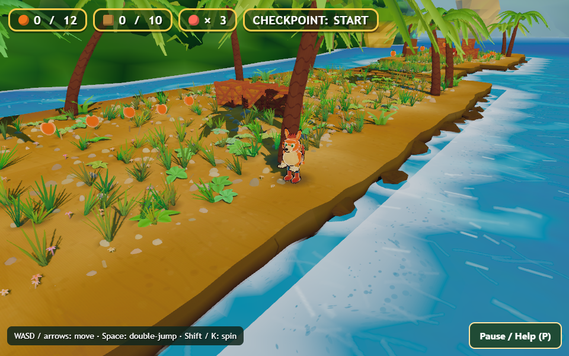
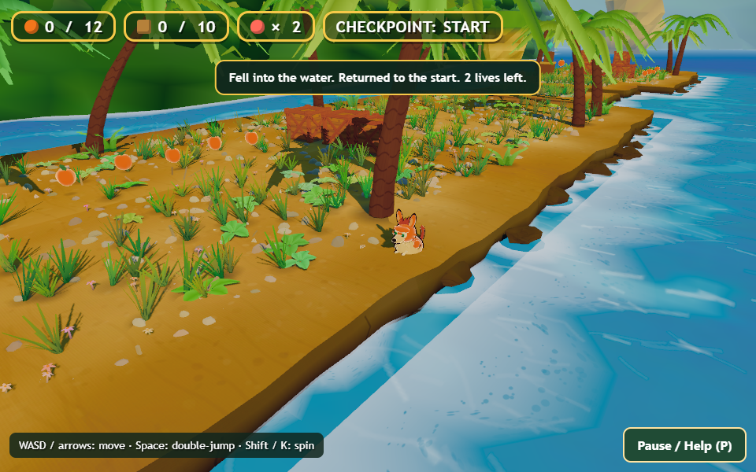
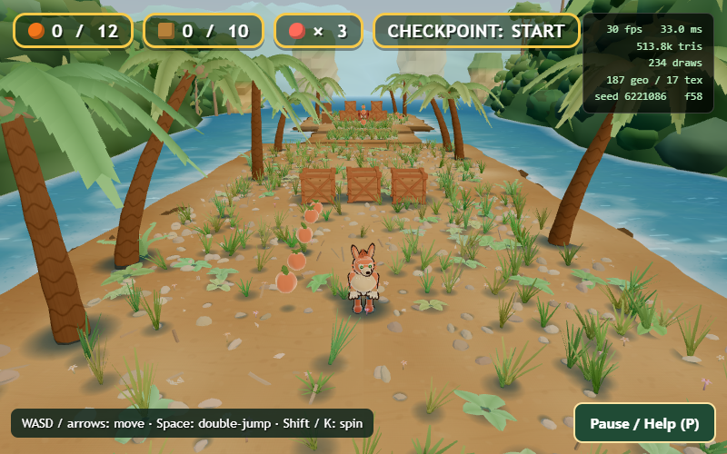
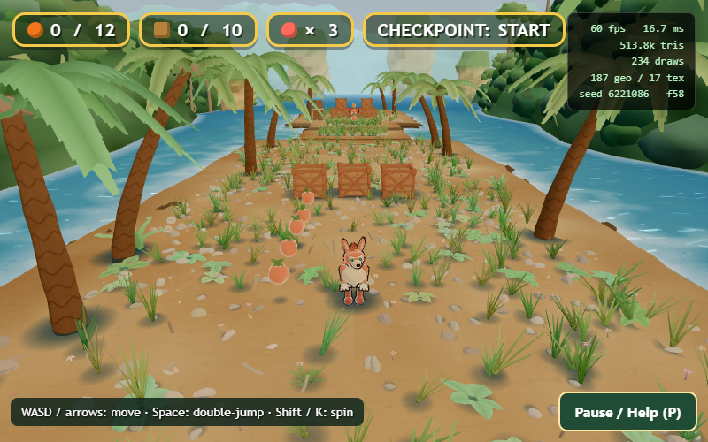

# Bandicoot Bonanza — targeted functional checks

Tested the current source snapshot on October 18, 2026. No game source changes, uploads, publication, account access, or itch visibility changes were made.

## Method and totals

Local `file://` snapshot, isolated headless Microsoft Edge, Playwright keyboard events and existing `BB` review API. Functional runs used a fixed 1/60 simulation timestep. `BB.place` established isolated fixtures; those are **not normal-route evidence**. The separate route agent owns the unteleported playthrough. Audio was muted; no auditory verdict follows from these runs.

- Existing gameplay suite: **19/19 passed**, `checks/baseline-playtest.log`.
- Existing onboarding suite: **6/6 passed**, `checks/baseline-onboarding.json` and `.log`.
- Existing session suite: **4/4 passed**, `checks/baseline-session.log`.
- Additional targeted suite: **16 functional assertions passed**, plus one positive diagnostic confirming the collision-lip issue. `checks/targeted-results.json` contains 17 entries; do not describe all 17 as defect-free tests.
- Follow-up: one stable inner-edge control, two repeated outer-edge deaths, two controlled frame-overlay diagnostics, one held-input observation.
- **13 screenshots** in `checks/`.
- No game runtime errors in completed checks. An initial sandbox Edge launch failed before game startup; rerunning with the authorized local process permission succeeded. That environment failure is excluded from game results.

Baseline scripts are copied unchanged except their shared harness points to the snapshot and selects Edge without forced SwiftShader. Snapshot source and generated index were not edited. All diagnostic scripts and raw results are retained. Headless/fixed-step results are functional evidence, **not hardware performance measurements**.

## Confirmed issue 1: visible sand extends beyond walkable collision

**Priority:** high; affects trust in jumps and landing edges.

**Location:** beach, x=7.35, z=-8; nominal beach right collider ends at x=7.0. The mesh is wider and shows a flat sand surface beyond that line.

**Reproduction:** establish the hero at `[7.35, 0, -8]`, stationary with no movement input, and let normal physics run. At frame 13, feet are at y=-0.657, with the character visibly sinking into the sand. Continue: a life is lost and the player respawns. Repeat produced the same result. Control at `[6.8, 0, -8]` remained at y=0 for 60 frames without losing a life.

**Expected:** flat, visibly traversable sand supports the player; alternatively the non-walkable margin must read as a steep/non-traversable edge before the collision boundary.

**Actual/frequency:** 2/2 outer fixtures lost a life; 1/1 inner control remained supported. Input and damage rules were unchanged. Fixture positioning and pinned diagnostic camera are disclosed; this is not a claim that the normal route fell here.

**Source:** `src/world/masses.js:43` builds `BoxGeometry(w+1.6, ..., d+1.6)`, while line 157 returns bounds based on nominal `w` and `d`. Top deformation and radial edge shaping mean blindly enlarging an AABB can create invisible support over water. `src/player/hero.js` tests the feet point against those rectangular solids.

**Fix direction:** derive collision and the visible playable top from a shared boundary; preserve artistic skirt/overhang outside it but make that margin visually non-walkable. Validate all four islands, straight edges, corners, takeoff, and landing. Acceptance: no point that reads as flat walkable sand produces a stationary fall, and no empty water gains invisible support.

Raw evidence: `checks/edge-respawn.json`, script `checks/edge-respawn.mjs`. The earlier `05-sand-edge-fall.png` only captures y=-0.072; use the stronger follow-up images above.

## Confirmed issue 2: destroyed crates leave large contact-shadow patches

**Priority:** medium; visible interaction/state polish defect.

Place hero by the yard at `[0,0,-50]`, spin to arm TNT, wait for its explosion, then return to view the cleared cluster. Six yard crates and TNT are gone, but their dark contact patches remain. This is visible in the normal route as well as the same-camera focused pair below. The focused images use `minfx` so these patches cannot be mistaken for dynamic sun shadows; source ties them to independent contact geometry.

**Source:** `src/world/beach.js:92` adds independent contact blobs through `ground(...)`. `src/game/rules.js:45` hides the crate mesh and marks its collider dead, but has no contact-blob reference to hide. TNT similarly hides its own mesh. Upper crate contact geometry is created at its elevated base. Fruit contacts are also separate (`beach.js:169`), but their residual visual impact was not separately isolated here.

**Fix direction:** give each prop ownership of its contact/shadow components; hide them on destruction/collection and restore them on full reset. Do not remove all contact shading globally: intact props need grounding. Verify both spin/stomp destruction, TNT chain destruction, respawn persistence, and restart restoration.

## Confirmed issue 3: F3 frame-rate display measures simulation time

**Priority:** medium; invalidates optimization and acceptance decisions based on the current overlay.

Injected an intentional 100 ms busy wait before each `requestAnimationFrame` callback in a test-only browser page. This does not modify the game source and is **not an estimate of ordinary game performance**. Independent `performance.now()` timestamps measured the actual callback intervals.

| Mode | Displayed by F3 | Independently observed | Sample |
|---|---|---|---|
| Normal delta time | 30 fps / 33.0 ms | 9.864 fps / 101.38 ms | Last 30 callbacks |
| Fixed 1/60 test timestep | 60 fps / 16.7 ms | 9.865 fps / 101.37 ms | Last 30 callbacks |

`src/main.js:84` clamps simulation delta to 0.033 or substitutes the fixed step; `src/review/harness.js:70–71` accumulates that simulation delta for FPS. Thus slow real frames can look like 30 fps and fixed-step tests can look like 60 fps regardless of wall time.

**Fix direction:** separate simulation delta from frame timing. Use real callback/monotonic wall timestamps for displayed FPS and frame-time percentiles; clearly label fixed-step mode. Keep draw/triangle counters separate from timing. Acceptance: controlled 100 ms callback delays show approximately 10 fps, independently of simulation step. Then conduct a clean unthrottled headed-browser performance pass on target hardware. Simulation slowdown below 30 fps is a related design/architecture concern to assess; this diagnostic does not itself establish normal hardware slowdown.

Evidence: `checks/perf-diagnostic.json`, `.mjs`, `.log`.

## Functional behavior verified

| Area | Evidence |
|---|---|
| Jump / double jump | First and second presses gain height; a third press does not reset upward velocity; lands on the initial floor without losing a life. |
| Coyote time | Jump succeeds two frames after first leaving the ledge; ten-frame delay expires the grace window. |
| Jump buffering | Space queued during descent at y=0.270 produces a grounded jump after landing; y=0.928 eight frames later. |
| Spin and stomp | Existing suite confirms crate break, bounce, removed collider, and spin-radius destruction. |
| Fruit/HUD | Existing suite collects five fruit by contact and reflects counters correctly. |
| Checkpoint | Existing suite activates Totem 1 and returns there on death with collected fruit retained. |
| TNT | Arming, 2.2-second fuse, clearing six nearby crates plus TNT, safe-distance survival, and one-life blast damage pass. |
| Paused TNT | Fuse remains exactly 1.900 seconds through 150 paused frames; lives unchanged. |
| Persistence / restart | Spent TNT and broken crates remain gone after death; Restart restores all nine normal crates, TNT, fruit, lives, and initial checkpoint. |
| Blur / queued input | Focus loss clears queued jump; Resume does not replay it; keyboard auto-repeat does not jump. |
| Pause input | Movement freezes; jump/spin pressed while paused are ignored. Resume clears held movement. Existing velocity decays after resume (about0.64m in this fixture), so this is input cancellation, not zero-momentum assertion. |
| Pause keyboard focus | Tab stays within Resume/Restart; Shift+Tab wraps correctly. |
| Zero lives | Starts a new run and provides a visible explanation. |
| Resize | Pause card fits 960×360, 640×360, and 320×568; primary actions remain reachable. This is layout coverage, not a claim of touch/mobile input support. |

## Observations requiring a design decision, not a proven bug

- **Held movement across automatic death/reset:** a deliberately held W remains active after the third-life fall. The new run moved from spawn z=-5 to z=-13.355 without a fresh keydown. This is consistent with retaining the physical held key, not evidence of a stuck key after release. Decide whether rapid retry should retain movement or require a release/new press and a brief orientation beat. Coordinate this with the respawn camera issue captured by the route agent. `checks/edge-respawn.json` contains the fixture evidence.
- **Lifetime diagnostic counters:** `fullReset()` resets player-visible counters but leaves cumulative `deaths` and `explosions`. That is not currently a user-facing defect. Name/reset them intentionally before using them in future run summaries.
- **Endpoint:** the help explicitly calls the crate yard a prototype endpoint; absence of a completion state is a production gap, not a claim that a promised full campaign is broken. The route agent independently tested this.
- **Spin cooldown:** baseline spin action worked, but no dedicated cooldown-boundary timing test was completed; do not claim it was separately verified.
- **No gamepad, touch, screen-reader gameplay, packaged/offline distribution, or audible sound pass was performed in this targeted check set.**

## Claude implementation priorities from these checks

1. Fix visual/collision alignment before changing jump strength or making gaps easier.
2. Remove orphaned contact components with their owners; preserve intact prop grounding.
3. Repair timing instrumentation before accepting any frame-rate claim.
4. Preserve the passing jump, pause, TNT, and persistence behaviors with meaningful regressions.
5. Resolve respawn input/camera orientation as one deliberate interaction design, then validate with an uncoached human player.
