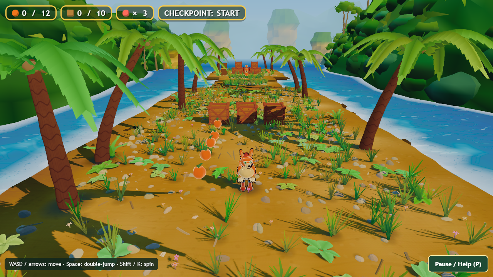
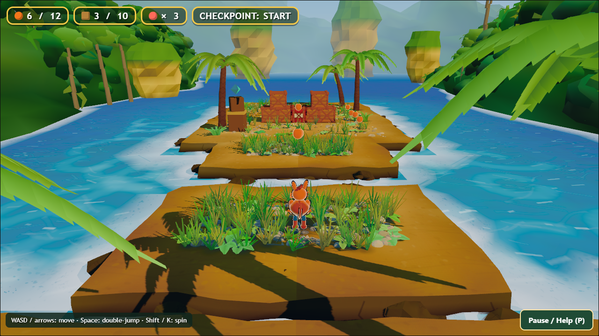
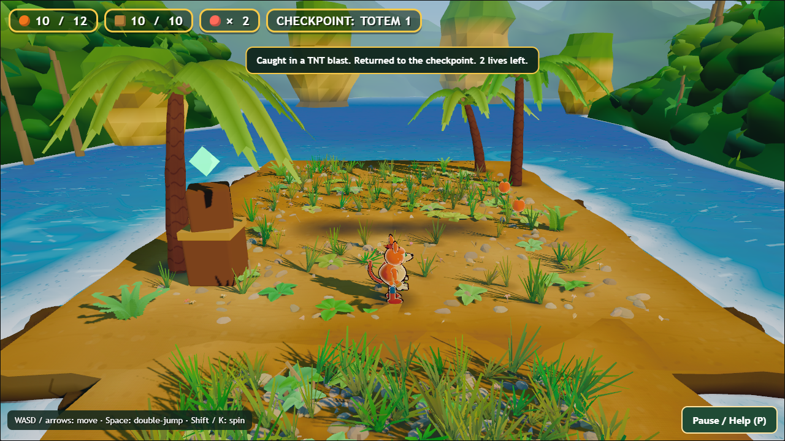
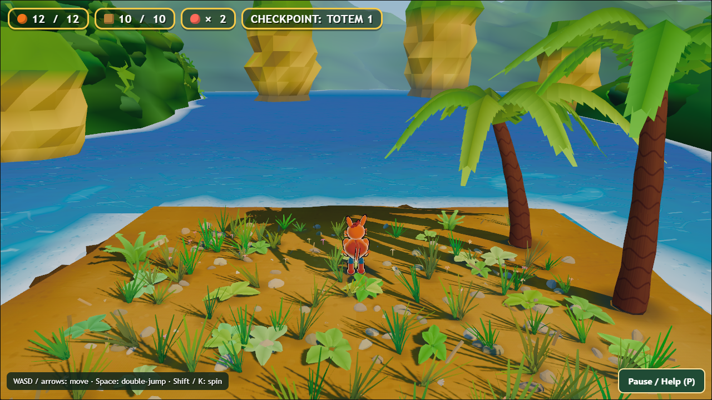

# Independent production critique — Bandicoot Bonanza

Review date: October 18, 2026. This critique combines direct inspection of fresh route screenshots with current frozen source. It is a second opinion for the main playtest report, not a claim that the critic personally completed a human playthrough. No source changes, hosted uploads, or account operations were performed.

## Verdict and scope

The highest-return next milestone is a **finished, readable, satisfying short prototype**, not more set dressing or nine more incomplete beats. The current playable scope is explicitly beach → stepping islands → checkpoint/crate yard (`src/world/beach.js:2,44–47`), with 12 fruit and 10 crate/TNT records. The Pause help correctly discloses that endpoint (`src/shell.html:45`). Judge this implementation against that scope; older references to all 12 original beats are future intent, not proof of missing broken content.

The existing presentation has designed crates, an identifiable outlined mascot, dense vegetation, shoreline foam and distance layers. Its main production gaps are hierarchy, tactile feedback, an ending, and consistent service of the actual play camera. A screenshot-only campaign can improve composed views while leaving those gaps unchanged.

Labels used below: **observed visual gap** = inspected current image; **source-confirmed gap** = implementation establishes absence/behavior; **hypothesis** = needs focused runtime validation; **roadmap** = proposed improvement, not a current defect. Refer to the main report and route/check test receipts for observed runtime outcomes.

## Highest-impact changes, ranked

| Rank | Change | Why this matters | Acceptance evidence |
|---|---|---|---|
| 1 | Give the crate yard an explicit completion and replay loop | A prototype needs to acknowledge success. Help text explains where it stops, but rules contain no goal/completed state. Continuing off an island must not be the only next interaction. | A normal fresh route reaches an unmistakable completion event; results correctly show collected/total; replay clears the intended counters and world, focus stays usable; no requirement to collect every fruit unless clearly stated. |
| 2 | Add coherent event feedback, especially TNT, crate break, checkpoint and death | Current rules mostly hide objects and update numbers; the player should understand cause, timing and consequence from play. | Muted video still communicates arming, countdown urgency, detonation and recovery. With audio, each event is distinct and balanced. Effects do not conceal the next landing or change collision timing. |
| 3 | Protect a readable running line and landing surfaces | The fresh screenshots show dense central grass, debris and sharp palm shadows competing with the small hero and target island. More geometry could worsen this. | Before/after ordinary-camera captures at takeoff, apex and landing show the hero's ground contact and landing boundary at 1280×720 and 960×540; moving capture has no distracting shadow shimmer; contrast remains without relying only on hue. |
| 4 | Make recovery and camera behavior deliberate | Instant player respawn with a camera left behind can create a whip/lerp rather than a controlled retry. This is an implementation risk needing runtime reproduction. | Falls from each island and TNT death return with a visible player, understandable destination and no unintended movement; compare camera snap, short transition and existing lerp before choosing; preserve responsive play. |
| 5 | Establish truthful performance and input/accessibility support | A sophisticated art target is not meaningful if the frame overlay measures simulated time. Keyboard-only operation and URL-only low-effects mode should be stated honestly. | Measure wall-clock RAF p50/p95 and hitch counts on an actual GPU; add visible graphics controls and persist preferences; retain keyboard focus/input regressions; implement and test controller only if claiming support. |

## Visual review of current ordinary play

### V1 — Visual density obscures the functional hierarchy (observed visual gap)

Evidence: `route/01-start.png`, `route/03-fruit-row.png`, `route/06-gap-approach.png`, `route/09-first-gap-landed.png`.

The running surface contains many thin grass blades, pebbles, broad leaves, flowers and high-contrast frond shadows. On the first small island, the central landing zone is densely planted; the player's boots and ground contact compete with the grass. The player remains identifiable because of its orange body and outline. This is **not** evidence of an invisible character or an impossible landing.

Cause worth testing: `src/world/beach.js:117–128` explicitly increased grass to 110 scatters on each small island to satisfy prior bare-ground critiques. The scatter biases away from the center but does not reserve a clean gameplay landing corridor. The old optimization was for a still's ground-cover percentage; ordinary play has a different priority.

Recommended change: author low-detail takeoff/landing masks, widen clean paths around interactive objects, and spend the saved visual budget on designed borders. Keep dense scenery outside the movement/readability zone. Do not blanket-delete foliage or flatten all shadows.

Counterargument: rich clutter is intentional stylization. That is compatible with a readable path; the goal is contrast in density, not an empty environment. Compare blind ordinary-play clips, not only beauty frames.

### V2 — Art cohesion remains procedural rather than production-finished (observed visual gap)

Evidence: the same opening and gap images. Palm fronds read as thin angular strips; distant green masses as repeated faceted clumps; the far sea stacks have broad polygon bands. The mascot is much more outlined than much of the environment. These choices are not rendering errors, and low-poly stylization can be a valid finish. The gap is inconsistent treatment and weak authored focal hierarchy relative to the repository's own premium mascot-platformer target.

Recommended change: choose a small style guide for silhouette scale, edge thickness, material roughness/lighting and detail frequency. Upgrade one palm, one cliff border, one foliage cluster and one hero interaction as a matched kit. Apply that kit throughout only after it wins in play-camera motion. Do not replace all procedural art or switch engines as the first response.

### V3 — Ground shadows are visually harsh and busy (observed stills; motion unmeasured here)

The fresh opening shows narrow high-contrast frond lines and dark patches on the path. These increase the noise of the landing plane. This critic has not established temporal crawling from still images. Avoid upgrading this to a confirmed shimmer defect without a moving capture.

`src/render/pipeline.js:100` already uses a 4096 shadow map, with camera-follow snapping. Raising resolution again is not an evidence-based first fix. Compare scene composition, caster density, contact treatment and shadow contrast under one render owner. Preserve chromatic shadows and the hero's grounding. Evaluate the cost and visible result together.

### V4 — HUD prioritizes four counters equally (observed visual gap)

The top row occupies almost half the width at 1280×720. Fruit and lives are colored circles, crate is a square; the icon shapes are only weakly descriptive. The checkpoint label is clear but relatively dominant. There is no main objective displayed during play beyond control hints.

Recommended change: concise identifiable icons/text labels, smaller secondary checkpoint status, brief pickup/checkpoint feedback, and a lightweight objective/completion cue. Keep high contrast and readable text; do not replace HTML accessibility with a canvas-only menu just for appearance. Avoid a busy quest panel in a three-beat prototype.

## Gameplay, feedback and camera

### G1 — No explicit ending (source-confirmed product gap)

`src/game/rules.js` tracks fruit, crates, lives, checkpoint, deaths and explosions; no completion state exists. `src/shell.html:45` tells players the prototype ends at the yard, but that instruction is in Pause help. This is a scope/UX gap rather than an assertion that a promised full campaign is broken.

Implement a small end-zone/objective after the safe TNT exercise with a short payoff, honest prototype wording, replay action, and optional collectible cleanup. Do not add a boss purely to disguise the missing conclusion. Do not require a backtracking completionist sweep unless the prototype teaches that goal.

### G2 — Rule outcomes lack an expressive event layer (source-confirmed production gap)

- Fruit: hide instance and increment HUD (`rules.js:28`).
- Crate: hide mesh, remove solid and increment HUD.
- TNT: scale pulse during fuse, then hide it and apply area damage (`rules.js:55–74`).
- Checkpoint: light totem and update HUD (`rules.js:80`).
- Death: instant respawn plus r03 cause/destination/life message (`rules.js:96`).

Introduce an event seam so VFX/audio/UI respond to existing gameplay events without changing the physics or taking ownership of game state. Give crate impacts readable debris/dust with short lifetime, fruit a tiny pickup accent, checkpoint a distinctive activation, and TNT a visibly distinct urgency sequence. A countdown or other time cue should correspond to the actual 2.2-second fuse. Use a brief nonblocking death/recovery transition if tests show it improves orientation.

Counterargument: hit-stop and shake are common polish tools. They are not automatically good here. Excessive hit-stop on fruit would interrupt flow; large shake makes depth jumps harder. Add them sparingly, with reduced-motion options, and require a measurable readability benefit.

### G3 — Camera recovery and vertical tracking (source-confirmed behavior; comfort hypothesis)

`src/main.js:94–96` only snaps camera on initial boot, then lerps its position toward hero plus offset each frame while looking directly at the hero. `hero.respawnAt` immediately moves the actor (`src/player/hero.js:71`). This can leave the camera at the previous death point during recovery. The earlier work-order record already listed camera snap on respawn; do not present it as newly discovered without reproduction.

Also assess whether following hero Y during jumps unnecessarily changes visibility of landing surfaces. Candidate approaches: separate horizontal progress from a damped vertical target, small look-ahead, and a recovery signal. Compare against current motion before altering the camera; an over-engineered camera with collision avoidance can introduce worse surprises in this simple corridor.

### G4 — Movement values are deliberately frozen (scope constraint)

`src/game/cfg.js` preserves earlier physics values including run speed, air acceleration, 0.12-second coyote and jump buffer, double jump and spin timing. Current evidence should not justify a broad rewrite merely because a scripted jump strategy failed. First distinguish missed timing, held-key behavior, collision defects, ambiguous landing depth and actual control problems. Keep meaningful controls regressions and run normal routes after any camera/art change.

### G5 — Expand encounter structure only after finishing the existing loop (roadmap)

The present sequence teaches collecting, crate interaction, gaps, checkpoint and TNT. A stronger version would introduce each mechanic safely, test it, combine it once, and end. Provide a visible safe escape area for the first TNT. Make the wide gap's double-jump requirement legible with spacing/collectible arcs or a brief first-use cue, not permanent verbose text.

Then expand one mechanic at a time: a second jump rhythm, optional safer/riskier collectible lane, or timed obstacle. Enemy AI, skill trees, crafting, multiple biomes and persistent currencies are poor first investments for this slice. They multiply unfinished systems without proving a compelling loop.

## Animation and audio

The hero already has idle asymmetry, procedural run, airborne pose, spin, ear and tail movement (`src/player/hero.js:142–189`). Calling it unanimated would be false. Missing production details are distinct takeoff/landing squash, anticipation/recovery, impact responses and stronger action silhouettes. These are proposed improvements, not verified foot-sliding defects. Confirm foot planting and spin readability in frame-stepped motion before changing cadence or limb lengths.

No audio system is present in inspected source, consistent with the contract's explicit 'no audio yet'. This is a known feature gap rather than a broken sound device. Prioritize jump/double jump, landing, spin, crate impact/break, pickup, TNT arming/explosion, checkpoint and recovery sounds, then sparse ambience/music. Mix by salience: danger over ambience, no clipping or stacked pickup loudness, volume/mute accessible before sound starts, browser audio resumed after a user gesture. Use approved/licensed or allowed procedural audio, keeping the delivery constraints explicit. A hearing-accessible visual countdown must remain even after audio exists.

## UI, input and accessibility

Preserve r03's focus trap, blur pause, discarded queued keys, scrollable help, and cause-aware recovery notices. Those are useful existing work, not gaps to replace.

Next practical improvements:

- Keyboard remapping or at minimum a documented alternative for each action. Shift can interact with operating-system sticky-key behavior; K is already an alternative.
- Esc as an additional pause key is conventional, but its absence is a design choice, not a broken advertised control.
- True gamepad handling with disconnect/reconnect, held-button suppression across menus, and matching prompts before advertising controller support. Current inspected player code uses keyboard listeners only.
- A visible quality/reduced-effects toggle; `?minfx` exists but players should not need to edit a URL.
- UI size, high-contrast/shape-coded collectibles and hazard cues, reduced motion and independent audio controls once audio is added.
- Distinct labels for counters and accessible names; retain semantic buttons, `role=dialog`, focus indication and status announcements already in HTML.
- State desktop keyboard support honestly. Adding touchscreen controls is a separate interaction-design project, not something implied by browser delivery.

Acceptance should include full keyboard-only play/menu use, tabbing in both directions, focus loss mid-jump and mid-fuse, low resolution/zoom, and controller tests only after implementation. Screen-reader-complete 3D gameplay is not established by a status role alone.

## Truthful performance and delivery

### T1 — FPS overlay measures simulation time, not elapsed rendering time (source-confirmed instrumentation defect)

`src/review/harness.js` computes FPS and milliseconds by accumulating the `dt` passed to `tick`. `src/main.js:84` supplies either fixed dt or `Math.min(clock.getDelta(), 0.033)`. Therefore:

- Fixed dt 1/60 produces an apparent ~60 FPS even if wall-clock frames are much slower.
- Normal runtime clamps long frames to 33 ms, so the display cannot accurately report sustained real rendering below ~30 FPS.

This makes F3 values unsuitable as real-GPU performance evidence. Keep simulation time for deterministic tests, but measure wall-clock RAF intervals separately. Label both clearly. Record device/browser/resolution/DPR/effects, warm-up, median, p95 and hitches over a repeatable route. Do not claim performance from software-rendered screenshots or triangle counts.

### T2 — Low-frame-rate slowdown (hypothesis needing controlled test)

The same 33 ms clamp discards elapsed time under long frames, potentially slowing movement and fuse progression relative to real time. Verify normal wall-clock movement/fuse duration at measured frame rates before changing it. A fixed-step accumulator with a bounded catch-up budget is a candidate, not an automatic drop-in fix; test collision and input timing under hitches and tab backgrounding. Preserve pause on blur rather than fast-forwarding hidden gameplay.

### T3 — Packaging claims need artifact-specific verification

Current source shell uses the pinned Three.js CDN import map; the prior r03 release document says its distributed ZIP bundles Three.js and has no CDN dependency. Those can both be true for different artifacts. Do not call the shipped game online-dependent simply from source, or call the current source offline-ready from an old ZIP receipt. Rebuild the exact distributable, extract cleanly, test without network, and hash the tested payload when a release update is authorized. This review does not authorize uploading or publishing.

Additional delivery gates: first-load error clarity, WebGL failure handling, real iframe keyboard focus, browser reload/restart, supported desktop browser checks, and performance quality fallback. Error logs and black-frame gates are separate from playability and art approval.

## Specification and review-method corrections

1. **Choose the current authority.** QUALITY-BAR describes r128/monolithic source/no build step, whereas the current gauntlet contract and implementation use r184/modules/build-to-one-file. Reconcile docs rather than silently enforcing whichever supports the current argument.
2. **Do not equate triangle count with quality.** A minimum of rendered triangles rewards redundant detail or multipass rendering. It is a budget statistic, not proof of rich design. Propose a documented amendment to quality gates; never move a threshold just to make the existing candidate pass.
3. **Do not optimize absolute shadow saturation alone.** Colorful shadows are an art direction, but readable form, hierarchy, correct material context and motion stability matter more than forcing every dark pixel above a universal saturation threshold.
4. **Beauty captures are necessary, not sufficient.** Composed cameras explicitly pin player pose and alter framing in beach.js. They do not prove ordinary camera comfort or jump readability. Keep title/close-up quality work, but promote builds only with actual play-camera routes too.
5. **Historical PASS is not current acceptance.** The status document carries September baseline/round labels, unmeasured audio/performance and a human playtest owed. Current r03 patches and this fresh review need their own evidence/version linkage.
6. **Avoid endless micro-polish without a player milestone.** Numerous source comments record tiny per-shot changes. Some are useful. A production plan should cap a pass by a playable acceptance goal, then run the whole route for regressions before another individual framing tweak.

## Suggested implementation order for Claude

1. Reproduce the main report's confirmed defects, preserve existing r03 changes, and establish a baseline source/artifact identity.
2. Finish endpoint/results/replay, event feedback and any verified recovery defect. Keep simulation behavior stable and rerun rules/input tests.
3. Run one ordinary-camera readability pass: landing zones, hero contact, TNT label/timing and path hierarchy. Use the fresh route screenshots as baseline, not solely old beauty plates.
4. Add a minimal, cohesive audio/animation response kit and accessible controls/settings. Verify muted and audible play separately.
5. Repair performance instrumentation; profile actual GPU frames and low-FPS behavior; choose target budgets and fallback behavior explicitly.
6. Ask an uncoached player to finish this short slice and explain controls, the TNT outcome and the ending. Measure confusion and retries. Only then expand content.

Do not switch engine, regenerate all approved artwork, add monetization systems, or widen scope to a campaign as a substitute for these acceptance goals. Keep the itch page private throughout development.

## Fresh route evidence addendum — lifecycle and ending

### D1 — Orphaned contact shadows after crates disappear (observed visual defect with source cause)

The normal-input route's `route/15-tnt-cleared.png` and `route/23-fall-checkpoint-recovery.png` show a soft dark band across the now-empty crate yard. Some darkening remains at upper-crate height, reading like floating grime or a shadow of an absent object. `route/05-crate-clear.png` shows similar residual dark patches after the first three crates disappear.

Source cause: `src/world/beach.js:83–94` creates a separate contact blob via `ground(...)` for each crate, including upper crates. `ground` adds that blob directly to the scene. `rules.js` hides the crate mesh and deactivates its solid but has no reference to that separate blob; the blob therefore outlives its object. The TNT's separate contact blob has the same ownership pattern. Fruit pools are also separate; check those during the focused lifecycle regression before claiming every class visually fails.

This is more concrete and should be fixed before a broad art pass. Make contact decoration owned by the gameplay prop or expose an explicit lifecycle handle: hide/remove when destroyed or collected, restore on full reset, and do not remove the player or scenery contacts by mistake. After a TNT chain clears a stack, no raised floating disc should remain. Test spin, stomp, TNT destruction, checkpoint recovery and full restart. A before/after view at the same camera pose should prove the cleared space is clean.

Counterargument: a scorch mark could intentionally remain after TNT. That cannot explain the pre-TNT crates' residual shadow or an elevated shadow plane. An intentional scorch effect should be authored on terrain and distinguishable from an orphaned contact blob.

### Endpoint is visible in fresh route, not only inferred from source

`route/20-endpoint-no-completion.png` shows 12/12 fruit, 10/10 crates, the player on the far end of the yard, and no completion acknowledgement. The broader route receipt should establish how long it waited and which actions followed; this still alone does not establish timing. It does directly support the absence of a visible ending in the completed collectible state.

### Do not overread the TNT death

The normal route lost a life to TNT, and the r03 recovery notice clearly explains the cause. A failed escape by one scripted route does not prove the fuse is unfair. Preserve that notice. Improve telegraph and consequence readability before changing the fuse or blast radius, and require separate safe-escape validation.
