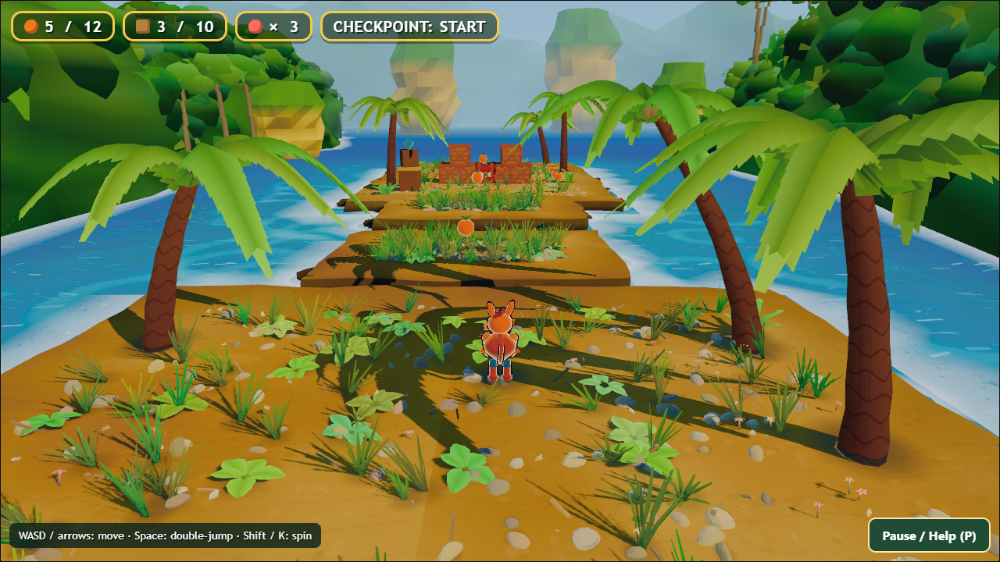
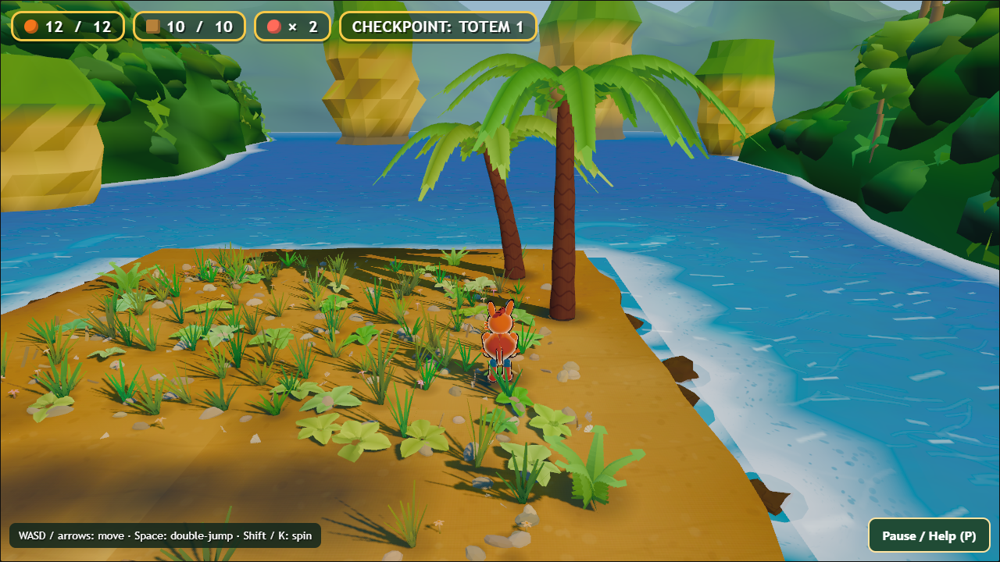
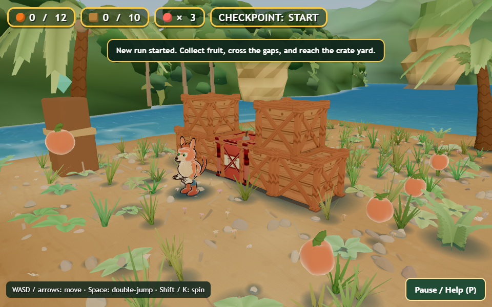
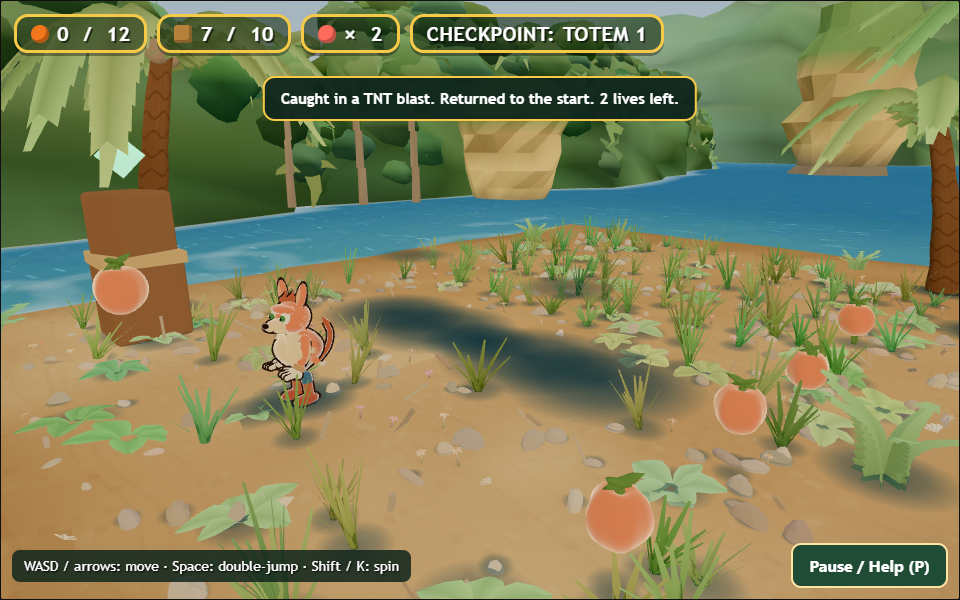
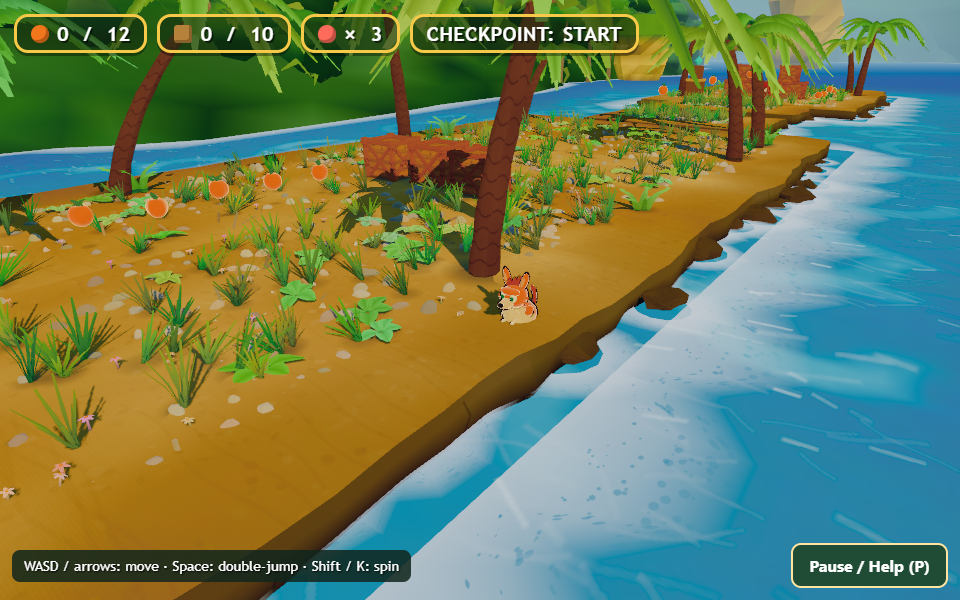

# Bandicoot Bonanza — comprehensive playtest and production review

October 18, 2026. Review of the current beach prototype, for Claude's next implementation pass. Keep itch private.

## Tested build and method

Repository: `C:\Users\scott\Documents\repos\games\bandicoot-bonanza\main`. Tested branch `claude/gauntlet-v2`, commit `3a1406f`, plus the existing uncommitted r03 onboarding/session changes. `source-manifest.json` records the frozen files. An in-memory rebuild reproduced the current index.html exactly: SHA256 `d762dcae9a37d613aa6b42339f85b960bb42343b574e3212fe9632f39051e03f`. See `build-consistency.json`.

The current playable scope is beach → water gaps → checkpoint/crate yard. Older twelve-beat plans describe future work; this report does not pretend those later sections exist. The prototype contains 12 fruit, nine standard crates and one TNT, one checkpoint, and three starting lives.

Testing uses real browser keyboard events with read-only observation and a fixed simulation timestep where disclosed. It is scripted play, not an uncoached human session. The natural route does not teleport, grant items, disable hazards, or change rules. Rendering continues during screenshot/tool calls, so requested settle counts are minimums, not exact key-hold frame counts or completion times. Targeted placed fixtures are separate and use the reduced-effects mode where documented; their colors/shadows are not a comparison against the full-effects route. Fresh isolated Edge sessions load local game files and their public CDN dependencies. No existing authenticated browser, account, itch editor, or hosted upload is involved.

Independent workstreams cover the route, targeted functional checks, and an adversarial source/visual critique. Confirmed bugs, production gaps, and hypotheses are distinguished below. This is a report/handoff task: no game fixes were applied.

## 1. Route outcome and evidence

The normal-input route reached the checkpoint with three lives and no deaths, then eventually collected **12/12 fruit and cleared 10/10 crate/TNT targets**. It exercised a TNT death, checkpoint recovery, a deliberate walk past the far boundary, and a later reverse-travel fall that exhausted lives and reset the run. There is no implemented victory transition to trigger. Counts surviving an ordinary death are intended current behavior; the full reset restored the initial collection/lives/checkpoint state.

Fresh existing regressions passed **19/19 gameplay, 6/6 onboarding, and 4/4 session/input checks**. Additional targeted assertions cover jump/double-jump, coyote/buffer, paused TNT/input and small-screen menus. Diagnostic assertions that successfully reproduce a defect are not counted as proof that the feature is correct. See the targeted report for exact counts and setup.

Read `ROUTE-REPORT.md` for the exact sequence, errors, reset outcome, and fixture exclusions. Read `CHECKS-REPORT.md` for fresh regressions and focused diagnostics. A completed collection route proves reachability under this script, not human difficulty, fun, or smooth real-time performance.

## 2. Findings and reproducible issues

### BB-01 — No in-world or session-level conclusion at the prototype endpoint

**Observed production gap; high priority for a public demo.** Traverse the beach and gaps, clear the yard and collect the remaining fruit, then continue toward the far end. The counts can read 12/12 and 10/10, but there is no finish marker, success feedback, result panel, or exit/replay decision. Continuing beyond the island produces an ordinary fall and life loss.

The Pause/Help panel does disclose that the prototype ends at the crate yard. Preserve that truthful scope statement. The missing piece is an understandable arrival and payoff during play, not a requirement to implement all future levels now. Source state is PLAY/REVIEW and rules have no completion trigger.

**Proposed behavior:** an authored, clearly visible endpoint with a short completion cue and optional summary/replay. Let players finish without mandatory 100% collection; reward collection separately. If free exploration after the finish is wanted, make that choice explicit. Do not strand the player behind a modal before the final pickup.

**Acceptance:** reach the endpoint with partial and full collections; finish exactly once; resume/explore/replay behave consistently; keyboard focus stays in the active panel; a new run resets completion and resources; deliberate post-finish falling cannot silently erase an earned result. Capture the actual final sequence.

### BB-02 — Detached contact-shadow lifecycle after crate destruction

**Confirmed visual defect, P2.** The natural route and identical-camera targeted TNT comparison both show dark contact patches remaining where the crate meshes disappeared. `src/world/beach.js` creates crate contact blobs separately in the scene; `src/game/rules.js` hides the broken crate mesh and disables its solid, but does not retire the associated contact blob. Upper stacked crates receive elevated contact discs, producing a conspicuous floating band after the stack is gone. Legitimate environmental shadows are a separate matter.

**Expected:** a destroyed object stops casting its object-specific fake contact shadow. Existing environmental/palm shadows remain. If a scorch mark is intended, it needs deliberate blast placement and appearance rather than surviving crate-contact geometry.

**Fix direction:** make the contact/decal object belong to the prop's lifecycle, including reset/rebuild. Inspect collected fruit for the same ownership issue, without assuming its subtle ground mark is equally noticeable.

**Acceptance:** identical-camera before/after captures for spin, stomp and TNT; no floating or orphaned contact disc; restarting restores exactly one matching contact object per prop; repeated resets do not accumulate nodes or darken the ground.

### BB-03 — Performance overlay measures simulation time, not actual frame delivery

**Confirmed instrumentation issue, P2.** `src/review/harness.js` accumulates the supplied simulation dt to calculate FPS/ms. `src/main.js` clamps real-time dt to 0.033, while deterministic tests use 1/60. An intentionally injected 100 ms delay before each animation callback produced approximately 101.38 ms wall intervals (9.86 frames/second), while the overlay reported 30 FPS/33 ms in real-time mode and 60 FPS/16.7 ms in fixed-step mode. The separate test cases and screenshots are in `checks/perf-diagnostic.json`.

This does not establish poor performance on a particular GPU. It establishes that the display cannot certify performance. Keep simulation stepping deterministic for tests, but measure real frame intervals independently with a monotonic wall clock.

**Acceptance:** simulated and wall-clock timing are clearly labeled; a controlled slower frame scheduler changes measured frame-delivery statistics; normal real-time capture records p50/p95/p99 intervals and target hardware/resolution; pause/inactive-tab intervals are separated rather than silently averaged into play. Treat motion slowdown caused by clamped dt as a separate behavior to validate before changing physics.

### BB-04 — Player falls through the visibly flat sand edge

**Confirmed collision/art mismatch, P1; beach x7.35, z-8. Reproduced 2/2.** A targeted stationary fixture at x6.8,z-8 stays on y0 with three lives for 60 frames. At x7.35,z-8, the character falls to y-0.657 after 13 frames while visibly submerged through the flat sand top, then loses a life and respawns. The repeat loses a second life in the same way. No movement key is required. `checks/edge-respawn.json` records both repetitions and the inner control.

Source: `src/world/masses.js` builds a box at w+1.6/d+1.6 before additional shaping, but its solid footprint remains the nominal w/d. On the beach, collision ends at x7 while the visually walkable top extends beyond it. A decorative overhanging cliff can legitimately extend past a collider; this captured flat sand top still reads as playable ground.

**Fix direction:** derive render and collision from one authoritative walkable boundary, or visibly shape/color the excluded lip as a steep, non-walkable skirt. Do not blindly expand rectangular collision through the entire carved cliff, because that can create invisible platforms elsewhere.

**Acceptance:** inner/boundary/outer probes around all islands, plus normal forward/backward/diagonal takeoff and landing. No foot sinks through a surface that reads as walkable and no invisible support projects into water. Repeat with the exact release rendering and appropriate camera; preserve current jump/coyote behavior. Add a meaningful boundary regression from the shared geometry contract.

### Camera recovery — observed concern, duration still unmeasured

The reverse-travel death that exhausted lives produced a far/disoriented view immediately after returning to the start (`route/25-reverse-landing.png`, despite that historical filename, is already after reset). The next capture shows the camera recovering. The follow camera lerps toward a target, while its snap flag is only initialized at startup. This is a concrete transition to inspect, but the captures do not establish its duration or human discomfort.

Test far-to-start and checkpoint resets with continuous video. Reinitialize or briefly transition the camera deliberately when teleporting the player for respawn, so the next required input is visible. Preserve normal smooth follow. A separate held-key test confirmed that continuing to hold movement intentionally moves the new run; that is an input-policy decision, not a stuck-key bug. Do not silently clear intentional input unless the retry design calls for it.

## 3. Feel and challenge

**Movement/jump.** Normal input can traverse the existing gaps and collect the available targets. The controller already includes acceleration, air control, coyote time, jump buffering and a double jump. Preserve those before tuning. The fixed-step route is not evidence of real-time responsiveness or player comfort. Record takeoff/landing, input timing and horizontal speed when investigating a miss; do not widen every platform after an automated failure.

**Camera and depth.** The follow camera gives a readable character outline and forward view. Its horizon-facing approach compresses the gaps in depth, while dense foliage and contrasting palm shadows break up landing surfaces. Make the legal landing edge and safe takeoff area easier to identify before changing the jump arc. Test backward travel, diagonal approaches, jump apex, landing, death and checkpoint respawn; inspect a short motion sequence rather than a single attractive framing.

**Spin and crates.** Crate breaking works as an objective but needs a stronger response: readable anticipation/active/recovery, localized break effects, distinct impact audio and reward feedback. Keep response immediate. A long hit pause or camera shake on every crate would become tiring and make precise landings harder. Confirm spin range against the visual pose; avoid secretly changing the radius just to match a screenshot.

**TNT.** The natural route demonstrates that TNT can arm, clear the cluster and kill the player, with a recovery notice. That death does not by itself prove an unfair blast. Make fuse status and escape space apparent during motion: a distinct arming sound, pulse/countdown cue, coherent blast radius feedback, and a brief explosion effect. Preserve a safe reachable escape at current speed. Keep warnings accessible without relying only on red coloring or sound.

**Difficulty/retention.** The prototype offers collection, spin/stomp interactions and gap traversal but no escalating encounter structure or final payoff yet. Finish a satisfying loop in this slice first. Then introduce new obstacles in a teach → combine → mastery sequence. The next content milestone should have a distinct gameplay purpose, not merely more decorative ground.

## 4. Readability and presentation

**Ground detail competes with the route.** Fresh captures show high-frequency grass, pebbles, flowers, shells and strong frond shadows across much of the running surface. The hero remains identifiable through its outline; calling it invisible would overstate the evidence. The issue is hierarchy: landing edges, interactive props and the next objective should attract attention before decorative detail.

Author quieter landing/run zones, cluster detail toward boundaries and landmarks, and use consistent edge/value treatment. Preserve the bright tropical palette and approved stylized direction. Do not solve this by globally removing vegetation or adding bloom/contrast everywhere. Validate actual play-camera frames at 720p and small-window size, including movement.

**HUD.** Counts are visible and stable, but a colored dot/square is a weak explanation of fruit/crates/lives. Use more recognizable silhouettes or brief labels, especially in grayscale and at smaller sizes. The large checkpoint group can consume precious width; give collection and lives a clear reading order. Do not hide essential controls behind unexplained symbols.

**Hero animation and identity.** The current outlined mascot reads as a separate actor, with procedural run, jump and spin poses. For a higher production standard, refine silhouette, material grouping, anticipation, planted-foot contact and transition continuity. Inspect front/back/side views at actual play size; detailed close-ups alone are insufficient. Do not replace an approved design or change body proportions without rechecking collisions, camera clearance and jump perception.

**World quality.** Flat frond planes, visibly faceted distant masses and repeated decoration remain recognizable procedural construction. Improve a small set of high-impact silhouettes and material transitions rather than maximizing triangles. The existing modeled island foundations and water framing should remain coherent with any revised terrain collision.

**Menus and feedback.** Pause/Help, keyboard focus containment and recovery notices are useful baseline work. Keep them. Add a clear start/finish flow and a deliberate settings entry when those functions exist. Make restart consequence explicit; avoid another confirmation on every ordinary retry. A public demo should explain its scope before a player reaches an unexplained edge.

## 5. Audio, accessibility, performance and delivery

Audio is deferred in the current plan; this review is not an audible mix assessment. A first complete audio pass should distinguish jumps/double jumps, footsteps/landings, spin, crate break, fruit, checkpoint, TNT arm/explosion, death/recovery, menu focus and completion. Add ambience and music around those information-bearing sounds, with voice limits and persistent independent volume controls. Keep provenance for every asset. Silent placeholder audio is planned work, not a newly discovered regression.

Keyboard works under the tested paths. Physical controller, touch, remapping, rumble and assist settings are not certified. Implement only the devices promised for the demo, then test actual devices, reconnect/focus loss, menu navigation and prompt switching. Add reduced motion/shake/flash and scalable readable UI as features, with behavioral tests. Do not claim a playable touchscreen game from a responsive pause panel alone.

The source index uses a pinned external Three.js CDN. The earlier r03 distribution report describes a separately bundled offline payload. This run validates the current source, not that hosted ZIP. Before any future upload, generate the intended final artifact, test a fresh extraction with network blocked if offline use is promised, and verify its hashes and actual embedded-host startup. Do not copy a CDN-dependent development HTML into an offline release by accident.

Benchmark only on declared hardware, browser, viewport and quality settings with wall-clock timing. Record frame-time percentiles, startup, context loss/recovery, high-DPI resize, repeated reset, memory trends and a longer soak. Software rendering and fixed-step F3 readings are not performance acceptance.

## 6. Top five changes, ranked

1. **Make surfaces and actions trustworthy.** Resolve any confirmed collision/art mismatch and prop-contact lifecycle errors; retain passing movement and input behavior.
2. **Finish the prototype loop.** Clear goal, arrival/payoff, summary and reliable replay, with truthful scope messaging.
3. **Improve route readability.** Quiet landing zones, recognizable interactive silhouettes and useful collection/TNT feedback.
4. **Finish one consistent presentation slice.** Hero transitions, designed props, break/impact effects, functional audio and coherent menus.
5. **Validate the real delivery.** Honest performance measurement, intended input devices, accessibility/settings, offline artifact and private-hosted flow before expanding content.

## 7. Work order for Claude and devil's advocate

Begin by comparing current source against the recorded snapshot; do not reintroduce a problem that a newer change has fixed. Reproduce each issue, capture before/after, and separate functional checks from visual judgment. Fix trustworthy interaction and completion first. Then finish one short representative slice and extend its proven standard to future beats.

The older QUALITY-BAR still refers to r128, no bundler and numeric geometry floors, while the current source uses r184 modules and a build tool. Clarify the authoritative current constraints and delivery contract. Triangle count, draw calls and saturation thresholds may be diagnostic data; they are not proof of polish or fun. Do not weaken approved visual intent, but stop using detail accumulation as a substitute for readability.

Do not introduce an engine migration, co-op, online services, procedural levels or progression systems as a response to these findings. Do not label all missing planned features bugs. Do not infer unfairness from a scripted death, or human fun from a passed regression. Keep scope small enough to finish and measure.

Remaining human checks should be concrete: unfamiliar-player discovery and comfort; actual target-device/controller behavior; audio listening; unresolved approved-art decisions; eventual publication approval. Prepare the build and test instructions first so Scott only needs to supply judgment or hardware access.

## Evidence index and limits

- `ROUTE-REPORT.md`, `route/trace.json`, route captures: native-key exploration and collection.
- `CHECKS-REPORT.md`, `checks/`: fresh regressions, diagnostic fixtures, captures and failures.
- `INDEPENDENT-CRITIQUE.md`: independent challenge and production priorities.
- `build-consistency.json`, `source-manifest.json`: tested artifact provenance.
- `CLAUDE-HANDOFF.md`: implementation prompt.
- `SCREENSHOT-GALLERY.html`: local screenshot index.

No uncoached human play, physical-controller/touch support, audio quality, hardware performance, final-package compatibility or publication readiness is certified by this packet. No game code was changed and no itch upload/publication occurred.
