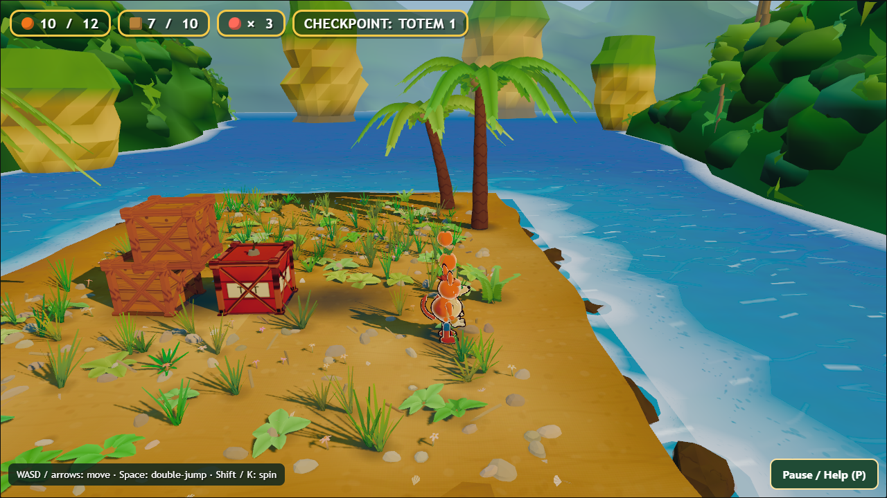
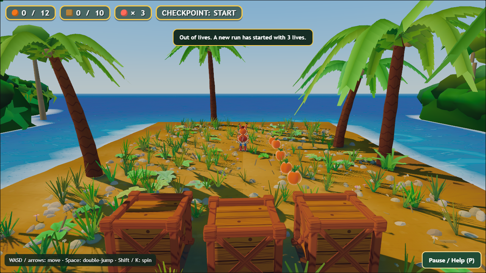

# Bandicoot Bonanza — normal-input route playtest

Tested October 18, 2026. Snapshot of `claude/gauntlet-v2`, commit `3a1406f`, including the existing local r03 changes. This report concerns the current beach prototype, not a complete campaign.

## Outcome

**The complete existing route and every collectible were reached using ordinary keyboard input: 12/12 fruit, 10/10 crates, checkpoint activated.** No teleport, invincibility, hazard suppression, direct counter mutation, camera override, or posed review framing was used. The successful collection run included one TNT death. Subsequent deliberate endpoint exploration and a failed reverse-jump strategy exhausted the remaining lives and demonstrated the normal run reset.

The forward route was traversable without a death through the checkpoint: beach → first stepping island → second stepping island → crate yard. All three water openings were crossed using single jumps. This does not prove that double-jump is redundant for all routes or all players.

**There is no in-world completion acknowledgment after collecting everything and reaching the far end.** The only explanation that this is the end of the prototype is in Pause/Help. Walking farther leads into water and consumes a life. This is a product/onboarding gap, not a claim that an implemented victory trigger malfunctioned.

## Method and limits

- Fresh isolated headless Microsoft Edge, 1280×720 viewport, local snapshot `index.html`; no signed-in state or accounts accessed.
- Playwright native keyboard actions. The only game harness calls were `BB.settle(n)` for waiting and read-only `BB.game()`/`BB.stats`/`BB.error` inspection. `fixeddt=1/60` was supplied in the URL.
- Normal game rules and ordinary source content remained active. All counters came from actual interactions.
- The game continues rendering between commands and during screenshot capture. Consequently the requested settle counts are **minimum frame advances**, not exact total key-hold durations. The controller was guided using source layout and state readback. This is a route feasibility/reproducible evidence exercise, not an uncoached human playtest or a measurement of intuitive difficulty.
- Audio was muted. No auditory quality judgment, normal hardware frame-rate claim, latency estimate, or real-time speedrun time can be drawn from this run.
- The route session remained open for inspection between command batches. Its total elapsed frame counter includes those idle intervals and should not be reported as level completion time. Command trace contains 1,500 requested wait frames across all actions, but additional frames also elapsed during tool overhead and inspection.
- The first attempted browser launch under the sandbox failed before loading the game. Relaunch with approved elevated execution succeeded. This is a test environment failure, not a game bug.
- No game source, hosted page, demo upload, or publication setting was changed.

Raw evidence: [route/trace.json](route/trace.json), [last result](route/result.json), [driver](route/driver.mjs). All 27 PNGs are original uncropped browser screenshots. The route's page error/console error array is empty and `BB.error` remained null.

## Route log

| Stage | Actual result | End position x,y,z | Evidence |
|---|---|---|---|
| Spawn/help/fruit row | 5/12 fruit, 0 crates, 3 lives | -1.99, 0, -11.17 | 01–03 |
| Spin first crate row | 3/10 crates, no death | 0.90, 0, -26.01 | 04–06 |
| Beach to first stepping island | 6 fruit, 3 lives | 0.06, 0, -34.66 | 07–09 |
| First to second stepping island | 7 fruit, 3 lives | 0.06, 0, -43.97 | 10–11 |
| Second island to crate yard | 8 fruit, checkpoint 1, 3 lives | 0.06, 0, -50.13 | 12 |
| Spin TNT cluster; escape right | TNT exploded, all 10 crates removed; 1 death; 10 fruit | 0, 0, -51.83 after recovery and next move | 13–17 |
| Collect remaining yard fruit | 12/12 fruit, 10/10 crates, 2 lives | approximately 0, 0, -59.39 after advancing | 18–20 |
| Explore far end and walk off | No completion; water death; counters preserved; 1 life | 0, 0, -47.3 after recovery | 21–23 |
| Reverse jump attempt | Failed; third death resets fruit/crates/checkpoint and restores 3 lives | Then ordinary new input moved from spawn to z=1.85 | 24–27 |

## Findings and concrete improvements

### R1 — The route ends without a satisfying or unmistakable finish

**Observed:** after 12/12 fruit and 10/10 crates, reached z≈-59.39, waited at least 180 additional frames, then approached the far shore around z≈-62. No goal marker, results card, celebration, next objective, or replay prompt appeared. The route continues visually into empty water. Walking forward costs a life, preserves the counters, and returns to the checkpoint.

**Expected product behavior:** a player who finishes a playable public demo should know they succeeded and what to do next. The current help truthfully identifies a prototype endpoint, so do not mislabel this as a broken existing win condition.

**Recommended:** place a clear destination at the yard end; trigger a short finish sequence with fruit/crate totals and a replay option. Let reaching the goal complete the demo; make 100% collection a bonus rather than an uncommunicated gate. If a prototype deliberately has no win condition, put a visible end-of-demo marker in the world and offer restart there.

**Acceptance:** first-time players can identify the endpoint without opening help, see a success state once, and restart without reloading the page; walking toward the indicated goal does not send them into a death pit.

Evidence: [18 complete collection](route/18-complete-collection.png), [20 no completion](route/20-endpoint-no-completion.png), [21 far end](route/21-far-end-no-goal.png), [23 recovery](route/23-fall-checkpoint-recovery.png).

### R2 — TNT danger communicates less than its actual effect

**Observed:** spinning near the central red TNT armed it and broke nearby ordinary crates. The strategy then moved right toward the fruit row, stopped, and waited. The TNT exploded, cleared the rest of the crate cluster, and killed the player. Recovery correctly retained collection progress and returned to the checkpoint with a useful explanation.

**Do not infer unfair damage:** the right-hand fruit row is at x≈4.3 and the blast is centered around x=0,z=-52. Source uses a 4.6 radius plus a 0.5 player allowance. The escape stopped close enough to be plausibly inside that distance. This was an inadequate escape strategy, not proof the damage check is wrong. No exact state sample was captured at the explosion frame, so do not claim an exact distance measurement.

The visual problem is that a player sees a red crate, a scale pulse, and then missing crates/recovery. There is no clear readable fuse countdown or floor-space cue in these ordinary views. The right fruit row appears like a safe reward lane, but it lies near the blast danger zone. Screenshot14 shows the pre-explosion scene after the lateral escape; screenshot15 shows its result.

**Recommended:** communicate the fuse with a clear escalating animation and sound, and deliver a short visible blast/debris event. A cartoon danger ring or strongly authored safe retreat route would help teach the radius once; avoid permanent debug-looking circles if a restrained presentation suffices. Test first-time escape comprehension before changing the 2.2-second fuse or damage radius.

**Acceptance:** a new player can distinguish dormant/armed/exploding TNT and identify a safe escape direction; the explosion is visible from the normal chase camera; the visual extent and damaging extent agree.

### R3 — Respawn camera can briefly give a disorienting view of the new spawn

**Observed once:** after the failed reverse-jump attempt exhausted lives, the hero snapped back to the beach while the follow camera was still recovering from its previous position. Screenshot25 captures the character small in the distance, crates huge in the foreground, and a viewpoint facing back toward the start. Screenshot26, after more frames, is the normal view again.

This is an actual screenshot of normal gameplay, but the run did not collect a frame-by-frame timeline of the camera. Its duration and severity at real-time hardware speed remain unmeasured. The reverse-jump failure itself may be caused by our driver timing: screenshots advance the simulation while airborne, and the braking input was issued afterward. It is not evidence that reverse jumps are impossible.

**Recommended:** reset the follow-camera spring/position on full run reset and use a deliberate short transition for checkpoint respawns. Ensure the destination is visually legible before accepting movement. Preserve immediate retry responsiveness; do not replace a brief camera problem with a long compulsory death sequence.

**Acceptance:** record a normal-speed far-to-start death/retry; the hero and safe ground remain readable from the first controllable frame. The camera must never sweep through the course or temporarily show the new spawn from the wrong side.

### R4 — Collection and destruction feedback are mechanically clear but visually thin

Observed counters update correctly for fruit, spin-broken crates, and TNT chain destruction. However, ordinary screenshots show collectibles/boxes simply gone and persistent dark areas where the cluster was. A still image cannot establish the complete motion of destruction effects, so use the targeted regression/source findings to classify whether these are missing effects or leftover ground decals.

**Recommended:** synchronize fruit-to-HUD pickup feedback, short wood fragments/dust, and a distinct milestone response at 12/12 and 10/10. Remove only shadows/decals that belong to removed objects; preserve environmental palm shadows and ground detail. Avoid an oversized particle burst that obscures the next landing.

Evidence: [04](route/04-spin-left-crates.png), [05](route/05-crate-clear.png), [15](route/15-tnt-cleared.png), [18](route/18-complete-collection.png).

## Feel and readability

- **Forward path feasibility:** all three water openings crossed without a death using normal single jumps, and the floating fruit helped signal the path. Preserve that readable route while improving finish/feedback.
- **Movement:** acceleration, momentum and air steering are visible in the displacement trace. Because this is a fixed-timestep automated route, do not present it as a human verdict on input latency or controller feel. Backtracking especially needs an actual player study because the camera keeps looking forward along the level.
- **Density:** dense grass, broadleaf clutter and long high-contrast palm shadows compete around feet and landing edges. The character remains readable in these frames, but the scene would benefit from calmer authored takeoff/landing areas. Do not strip the whole beach; make interaction zones clear.
- **Depth:** from the first stepping island, successive small islands and the crate yard partly overlap visually. Fruit and shoreline foam help; a distinct silhouette/landing rim could improve judgement without adding UI arrows everywhere.
- **HUD:** totals made collection goals obvious, but the life icon is an unlabeled red circle and crate icon is a square. More recognizable authored icons, accessible labels and celebratory full-count feedback would feel more finished.
- **End composition:** the far shore gives an uninterrupted water horizon. It reads like the level stops being built, not like an intentional finale. An authored goal landmark would improve both navigation and emotional payoff.
- **Art identity:** the orange mascot, crate breaking, fruit, tropical corridor and spin together closely evoke an established franchise. Developing a distinctive silhouette, movement flourish, fruit/prop vocabulary and world premise is a creative positioning recommendation; this is not a legal assessment.

## What this route proves and does not prove

**Verified:** normal movement reaches the entire current prototype; all 12 fruit and all 10 counted crates/TNT can be collected; three forward openings are traversable; checkpoint activates; TNT arms/explodes and affects crates/player; death retains partial progress; losing the last life resets counters/checkpoint and restores three lives; help/pause opens; no captured runtime error.

**Not verified here:** real-time performance, audible sound/music, controller support, touch/mobile play, cold offline startup, keyboard remapping, all collisions/edge geometries, all jump timing windows, replay/reset camera duration, the public hosted ZIP, or any content beyond this prototype. Other report sections may add targeted coverage; do not silently promote source inspection into gameplay proof.

## Screenshot index

All paths below are relative to this report:

1. `route/01-start.png` — unmodified starting view.
2. `route/02-help.png` — initial Pause/Help instructions.
3. `route/03-fruit-row.png` — natural 5-fruit pickup and first crate approach.
4. `route/04-spin-left-crates.png` — first spin interaction.
5. `route/05-crate-clear.png` — first row cleared.
6. `route/06-gap-approach.png` — beach approach to water route.
7. `route/07-first-takeoff.png` — first jump setup.
8. `route/08-first-gap-airborne.png` — first jump in motion.
9. `route/09-first-gap-landed.png` — first island landing.
10. `route/10-second-gap-airborne.png` — second jump.
11. `route/11-second-gap-landed.png` — second island landing.
12. `route/12-checkpoint-yard.png` — normal entry, checkpoint, eight fruit.
13. `route/13-tnt-armed.png` — spin arms TNT among crates.
14. `route/14-tnt-escape.png` — move to the right fruit lane before blast.
15. `route/15-tnt-cleared.png` — blast death and recovery notice.
16. `route/16-all-collectibles.png` — misleading capture label: actually 10/12 fruit, 10/10 crates; use counters, not filename.
17. `route/17-tnt-death-recovery.png` — recovered run continues.
18. `route/18-complete-collection.png` — actual 12/12 and 10/10.
19. `route/19-endpoint.png` — approaching empty end.
20. `route/20-endpoint-no-completion.png` — waiting with full counts produces no finish state.
21. `route/21-far-end-no-goal.png` — far shore, no goal marker.
22. `route/22-end-edge-fall.png` — intentionally walking beyond endpoint.
23. `route/23-fall-checkpoint-recovery.png` — normal recovery, full counts retained.
24. `route/24-reverse-jump-visibility.png` — reverse-jump attempt toward camera.
25. `route/25-reverse-landing.png` — misleading capture label: failed jump has already triggered full reset; transient wrong-side camera.
26. `route/26-final-life-reset.png` — restored camera after new input from spawn, counters reset.
27. `route/27-paused-after-reset.png` — Pause/Help after reset.

## Priorities for Claude

1. Give the current route a deliberate finish, results, and replay loop.
2. Make TNT state, explosion and safe escape legible while preserving proven rules.
3. Verify and correct respawn camera transition with frame-by-frame normal-speed evidence.
4. Finish interaction feedback and clean up prop-owned remnants after destruction.
5. Author clear landing zones and a distinctive destination/mascot identity before adding more islands or systems.

Avoid changing jump physics solely because one automated reverse-jump strategy failed. Preserve the normal forward collection route, and add meaningful acceptance evidence for each improvement rather than only comparison screenshots.
